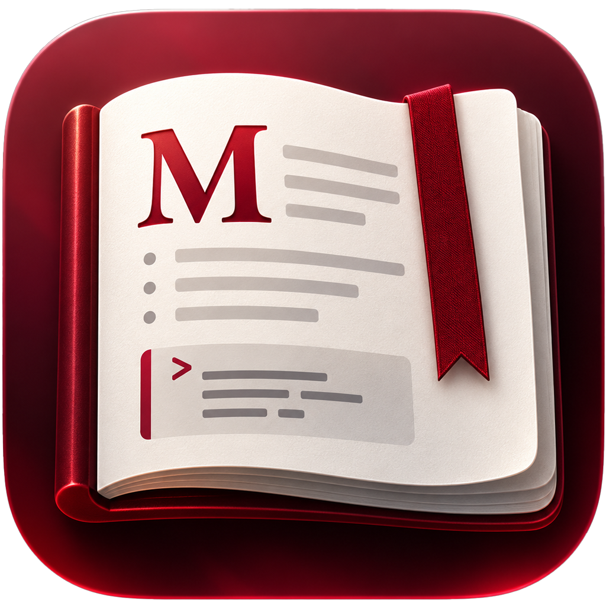

<p align="center">
  
</p>

# CrimsonViewer

CrimsonViewer is a lightweight native Markdown viewer for macOS, built with SwiftUI.

It is designed for quickly opening and reading Markdown files without the complexity of a full editor.

## Features

- Native macOS application
- Multi-document interface
- Open multiple Markdown files in separate windows
- Native File → Open support
- Finder integration
- Can be set as the default application for Markdown files
- Drag and drop Markdown files into an open window
- Markdown rendering
- Tables
- Headings and lists
- Inline code
- Styled fenced code blocks
- Horizontal scrolling for long code blocks
- Local and remote images
- Relative image paths resolved from the Markdown document location
- Text selection
- Find with **⌘F**
- Matching Markdown blocks are highlighted while searching
- Automatically scrolls to the first matching block
- Support for `.md` and `.markdown` files
- Native About and Help windows
- Lightweight SwiftUI interface

## Screenshots

_Screenshots coming soon._

## Requirements

- macOS 27 or later
- Xcode 27 or later
- Swift

CrimsonViewer intentionally targets modern macOS only. Compatibility with older macOS versions is not a goal.

## Dependencies

CrimsonViewer uses [MarkdownUI](https://github.com/gonzalezreal/swift-markdown-ui) for Markdown rendering.

Dependencies are managed with Swift Package Manager.

CrimsonViewer provides its own image provider for loading local Markdown images while retaining support for remote images.

## Development

CrimsonViewer is developed with Xcode 27 for macOS 27.

Open `CrimsonViewer.xcodeproj` in Xcode and run the `CrimsonViewer` target.

The project is intentionally small and focused. It uses SwiftUI's native document architecture, allowing macOS to handle document windows, standard file commands, recent files, and Finder integration.

MarkdownUI is used for rendering, while CrimsonViewer adds its own styling and behavior for features such as code blocks, local images, and document search.

## Usage

Open a Markdown document using:

- **File → Open…**
- **⌘O**
- **Open With → CrimsonViewer** in Finder
- Double-clicking a Markdown file if CrimsonViewer is configured as the default application
- Dragging one or more Markdown files into a CrimsonViewer window

Each document opens in its own window.

### Search

Press **⌘F** to open the Find bar.

CrimsonViewer searches the document as you type. Matching Markdown blocks are highlighted, providing the surrounding paragraph or code block as context rather than highlighting only the matching characters.

The document automatically scrolls to the first matching block.

### Images

Standard Markdown image syntax is supported:

```markdown
